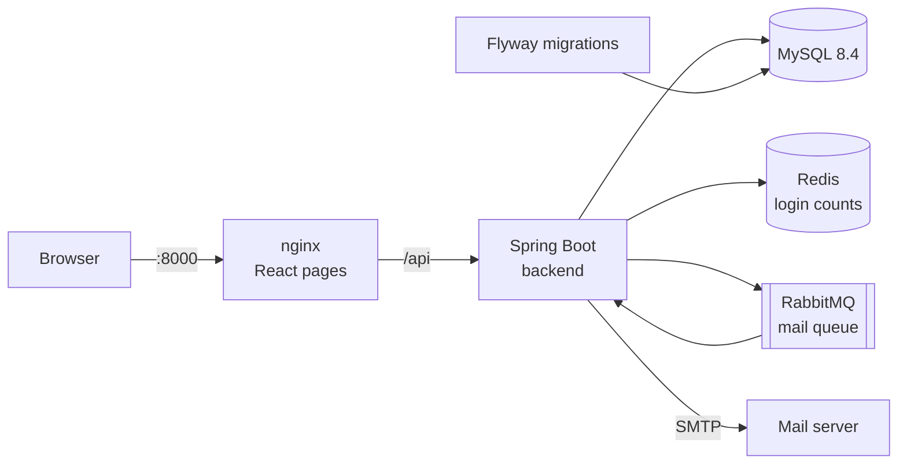

# OpsFlow

[](https://github.com/badanimer/java-opsflow-project/actions/workflows/backend-tests.yml)
[](https://github.com/badanimer/java-opsflow-project/actions/workflows/frontend-tests.yml)
[](LICENSE)

OpsFlow is a full-stack back-office system for orders, inventory, and operations tickets, built with Spring Boot, MySQL, and React. Several people change the same stock, orders, and tickets at the same moment, and the system is built so that none of those changes can break another: every write path has a stated lock order, a race test against a real MySQL, and an audit row.

The repository holds the backend, the frontend, the database migrations, a one-command Docker Compose deployment, and the design documents behind all of them.

## Highlights

- **Concurrency by design.** Pessimistic row locks taken in one fixed order across all modules, with a retry on a deadlock. Each race in the design has a test that releases several threads at the same moment against MySQL in a container: two orders for the last item, a reassignment against a resolution, a delisting against an order, and more.
- **Least privilege in the database.** The application account has rights per table. History tables such as stock movements, order lines, and audit logs accept `INSERT` only, so the database itself refuses to rewrite them.
- **Safe orders.** An order takes the stock in one transaction, an idempotency key makes a repeated click place one order, and every attempt, a refused one included, gets a number a person can quote in a ticket.
- **Security.** BCrypt and a signed JWT, one signed-in device per account (a newer login ends the older one at once, through a server-sent event), and a login lockout counted per client address in Redis, so an attacker cannot lock the real owner out.
- **Permissions checked by the build.** Every endpoint declares its permission; an endpoint with no declaration fails a test. Roles map to permissions in one enum, and the frontend shows a control by permission, never by role.
- **Architecture rules as tests.** A test reads the compiled classes and fails when a module uses another module's repository, when a controller reads the database, or when shared code depends on a module.
- **Reliable mail.** Mail goes through a durable RabbitMQ queue with three tries and dead letters, and never inside a database transaction.
- **Keyset paging** on every list, times stored in UTC, and request ids on every response and log line.

## Architecture



The backend is organized by feature: `auth`, `user`, `warehouse`, `order`, `ticket`, and `log`, with shared code in `common`. It uses plain JDBC through `JdbcTemplate`, so every SQL statement and every lock is visible in the code. Redis and RabbitMQ hold nothing that cannot be lost: when one is down, logins and mail go on without it.

## What It Does

| Area | What a person can do |
| --- | --- |
| Accounts | Sign up with an email code, log in, recover a password by email. One signed-in device per account. Wrong passwords lock out the address they came from, not the owner |
| Users and roles | Four fixed roles (administrator, manager, operator, viewer), combined per user. Administrators and managers change roles, disable, enable, and delete accounts, within their authority, always with a second confirmation |
| Warehouse and products | Add warehouse items with a generated SKU and a picture, put them on sale with a price, delist them, and delete them. Stock in, write off, and correct a count, each with a reason |
| Orders | Order from the product page. The stock is taken in one transaction, and a repeated click places one order |
| Tickets | Open a ticket on an order or on warehouse items. Take it from the pool, assign, reassign, release, resolve, cancel, and archive it, with limits per person and a history of every hand-over. The system opens, cancels, returns, and archives tickets on its own when the data they depend on changes |
| Logs and audit | A product log and a warehouse log, with a time filter and a search by order number, and an audit log page for administrators and managers, in seven areas |

What each role may do is the [Permission Matrix](docs/database/database-design.md#permission-matrix). Every page was drawn in [Figma](https://www.figma.com/design/68brMszRAYI4d261GKL1GU) before it was built, and is described in the [page design](docs/frontend/page-design.md).

## Tech Stack

| Part | Choice |
| --- | --- |
| Backend | Java 17, Spring Boot 4, Spring Security with BCrypt and a signed JWT, plain JDBC through `JdbcTemplate`, Flyway |
| Database | MySQL 8.4, with per-table rights for the application account |
| Cache and queue | Redis for the login counts of each client address; RabbitMQ for the mail queue, with retries and dead letters |
| Frontend | React 18, TypeScript, Vite, Ant Design |
| Tests | JUnit 5 and Testcontainers (MySQL, Redis, and RabbitMQ in containers); Vitest with Testing Library |
| CI | GitHub Actions runs both test suites, the lint, and the build on every push |
| Deployment | Docker Compose with nginx in front, and Spring Boot Actuator for the health check and the counters |

## Running It

The whole system runs on one machine with Docker Compose. It needs Docker and PowerShell (Windows, or `pwsh` on macOS and Linux).

```
cd deploy
./new-env.ps1                                     # once: random passwords and a signing key in .env
docker compose up -d --build                      # MySQL, migrations, Redis, RabbitMQ, backend, nginx
docker compose run --rm backend create-admin      # once: the first administrator, at a hidden prompt
```

Then open `http://localhost:8000`, log in as that administrator, and give roles to the people who sign up. Sign-up and password recovery send an email code, so they need the `OPSFLOW_MAIL_*` variables set in the shell. The details are in [Deployment](docs/backend/backend-design.md#deployment).

For development, the backend and the frontend run on their own against local services: see [environment-setup.md](docs/environment-setup.md).

## Tests

| Suite | Command | What it covers |
| --- | --- | --- |
| Backend | `mvnw test` in `backend/`, with Docker running | 459 tests, most of them against a real MySQL, among them the race tests. Each one is listed in the [test log](db/verification/concurrency-tests.md) with what it shows and the design rule it supports |
| Frontend | `npm test`, `npm run lint`, `npm run build` in `frontend/` | 294 tests that drive whole pages for each role against a fake server |
| Database | [`run-db-verification.ps1`](db/verification/run-db-verification.ps1), by hand | 162 checks of the schema, the rights, and the order and stock races, in a temporary database |

## Documentation Structure

```
backend/          Spring Boot application, its tests, and its Flyway migrations
frontend/         React application and its tests
deploy/           Docker Compose deployment
db/admin/         Per-table rights of the application account
db/verification/  Database verification script and the test log
docs/             Design documents
```

- [`docs/database`](docs/database/): the [database design](docs/database/database-design.md), with the tables, the order and stock flows, the lock order of every write path, and the Permission Matrix. Diagrams: [Simplified ERD](https://www.figma.com/board/FTesM5Ue6WpNV6GcipdfK9/OpsFlow-Database-ER-Diagram?node-id=0-1), [Physical ERD](https://www.figma.com/board/GNiX9p2D1tTfKvqPs8L9DQ/OpsFlow-Initial-Physical-ERD?node-id=0-1), and [Business Process Flowchart](https://www.figma.com/board/At5VgWJp5LHbFl2qZYZzKn).
- [`docs/backend`](docs/backend/): the [backend design](docs/backend/backend-design.md): the stack, the layout, the configuration, the tests, and the deployment.
- [`docs/api`](docs/api/): the [API conventions](docs/api/api-design.md): the paths, the formats, the error response, the result codes, and the paging.
- [`docs/frontend`](docs/frontend/): the [page design](docs/frontend/page-design.md) and how to run the frontend.
- [`docs/iterations`](docs/iterations/): one file per design iteration, with what changed, why, and which decisions were made, indexed in the [Project Log](docs/iterations/README.md).
- [`docs/environment-setup.md`](docs/environment-setup.md): the development environment.
- [`docs/project-todo.md`](docs/project-todo.md), [`docs/implementation-roadmap.md`](docs/implementation-roadmap.md), and [`docs/future-ideas.md`](docs/future-ideas.md): the open work, the order in which it was built, and ideas for later.
- [`docs/documentation-sync-rules.md`](docs/documentation-sync-rules.md): which documents change together and how an iteration is recorded.

## How It Was Built

The design came first: each module's tables, flows, lock order, and permissions were written down and reviewed before its code, and each change was recorded as an iteration. The code was written with an AI coding assistant (Claude Code), working under the rules in [`CLAUDE.md`](CLAUDE.md) and [`documentation-sync-rules.md`](docs/documentation-sync-rules.md). The design decisions were the author's, and each phase was clicked through by the author against the running system before it was merged.

## Status

All eight phases of the [implementation roadmap](docs/implementation-roadmap.md) are built and were checked against the running system. One question is still open: how people are told that the system cancelled their ticket ([project-todo.md](docs/project-todo.md)). Ideas for after the program is complete, such as more than one instance and a server on the internet, are in [future-ideas.md](docs/future-ideas.md).

## License

[MIT](LICENSE)
